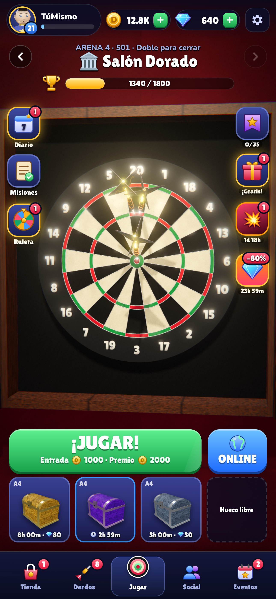
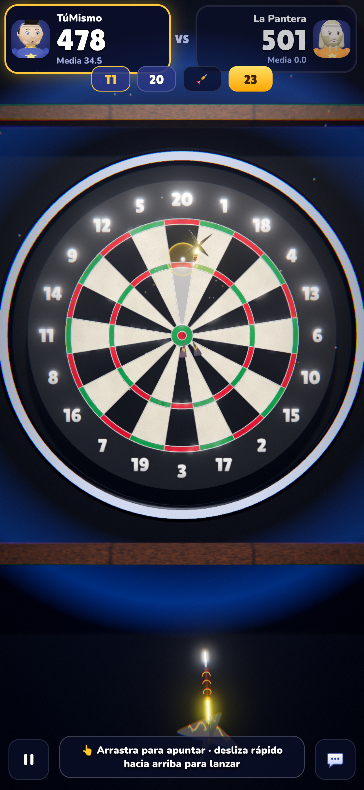
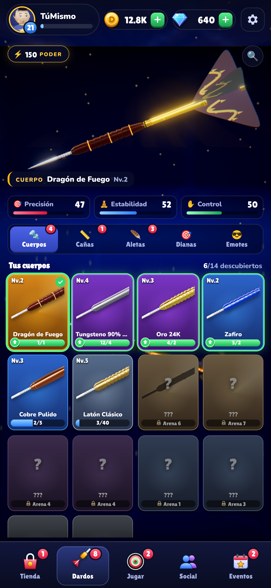
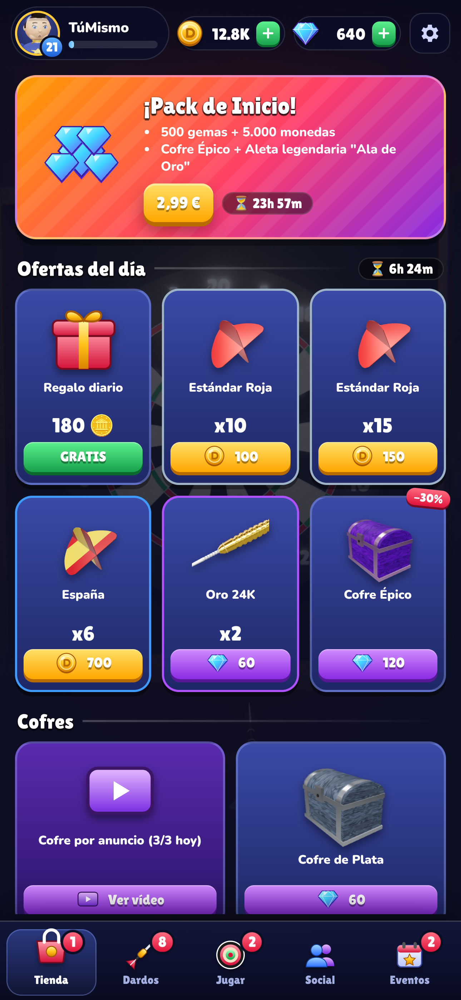
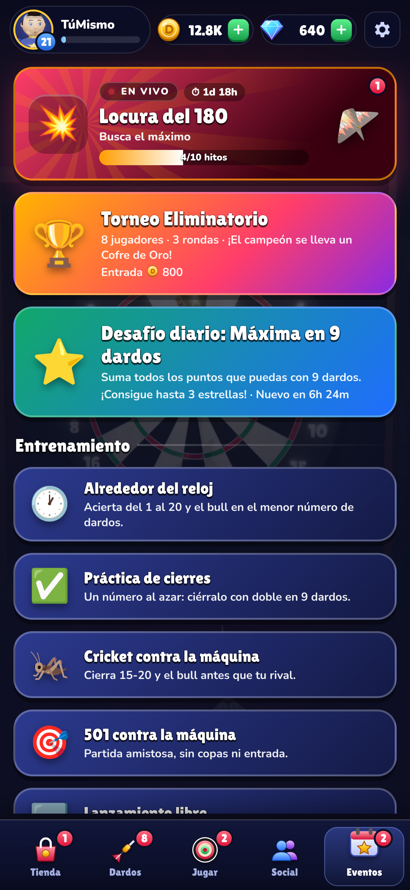
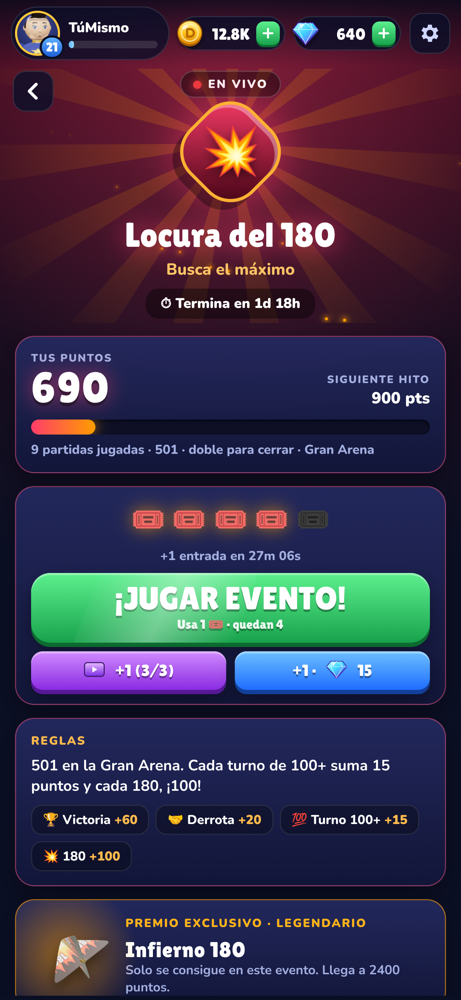
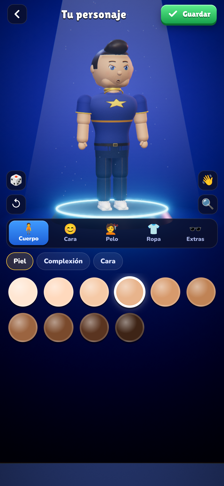
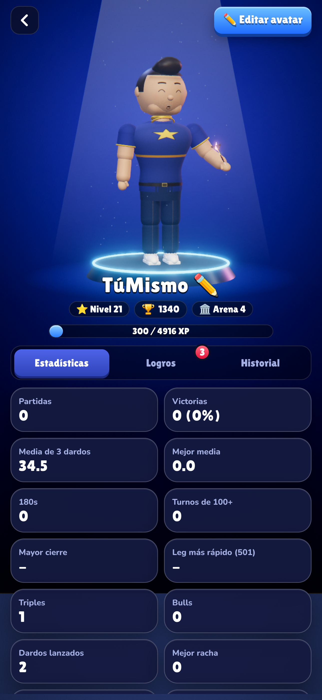

# 🎯 Diana Legends — Dardos 3D

Juego de dardos 3D realista para **iOS y Android** (y navegador), con partidas contra bots y online,
colección de dardos mejorables, cofres, arenas, clubes, pase de temporada, tutorial y monetización
con anuncios y compras.

| Inicio | Partida | Colección | Tienda |
|---|---|---|---|
|  |  |  |  |

| Eventos | Evento en vivo | Editor de personaje | Perfil |
|---|---|---|---|
|  |  |  |  |

## Qué incluye

**Jugabilidad**
- Diana de sisal con medidas oficiales, araña metálica 3D, números, desgaste y armario de madera con pizarras.
- Control táctil: **arrastra para apuntar**, mantén el dedo quieto para concentrarte (el círculo se encoge) y **desliza rápido hacia arriba** para lanzar. La fuerza y la dirección del gesto influyen en el tiro. Modo "Soltar (fácil)" para accesibilidad, ajuste de sensibilidad y modo zurdo.
- Física de vuelo con estela, vibración al clavarse, rebotes en los alambres, polvo de sisal, chispas y onda expansiva en triples y bull, resaltado del segmento, **cámara lenta cinematográfica en el posible 180**, público y flashes.
- Iluminación de cine: haces de luz volumétricos con polvo en suspensión, humo ambiente, anillo LED profesional en los estadios, materiales con barniz (clearcoat), gradación de color por arena, viñeta, grano y bloom.
- Modos: **301 / 501** (doble para cerrar, legs), **Cricket**, **Alrededor del reloj**, práctica de cierres, lanzamiento libre, partida local de 2 a 4 jugadores, **online 1v1** y salas privadas.
- IA con 7 niveles de dificultad calibrados (de ~20 a ~100 de media) y tabla de cierres profesional; pista de cierre en pantalla.
- **Zona objetivo iluminada en la diana**: cuando tienes cierre se enciende el segmento al que tirar (verde «¡CIERRA!» si ese dardo gana, dorado si es parte de la ruta), con un aviso «¡Puedes cerrar!» al empezar el turno. También marca el número que toca en Alrededor del reloj y el recomendado en Cricket. Al apuntar ves el nombre del segmento bajo la mira y notas una vibración al cambiar de zona.
- Se ve cómo apunta el rival (su mira se asienta antes de lanzar) con cámara de retransmisión en su turno; **racha «en llamas»** con dos o más turnos de 100+ seguidos (estela de fuego y más chispas); marcador que cuenta hacia abajo, sacudida al pasarte, **revancha** con un toque desde los resultados y dardos de exhibición en el fondo del inicio.
- **Zona bonus ★ en cada turno** (partidas con apuesta: clasificatorias, online, eventos y torneo): se ilumina en dorado un simple, doble, triple o el bull con su premio en monedas, que crece con la arena. Tirar a por ella o a por los puntos es decisión tuya.
- **Combos**: triples, dobles, bull o bonus seguidos encadenan un combo con sonido que sube de tono; desde x3 cada dardo bueno suma monedas. El bonus y el mejor combo aparecen en los resultados.
- **⏩ Acelerar** el turno del rival con un toque (x2, se mantiene durante la partida) y un ritmo entre turnos más ágil.
- 7 arenas con escenarios propios: Pub de Barrio, Taberna del Puerto, Club Neón, Salón Dorado, Gran Arena, Campeonato Mundial y Olimpo de Leyendas.

**Progresión y enganche**
- Monedas, gemas, nivel con recompensas, copas y ascenso de arena.
- 52 piezas coleccionables (cuerpos, cañas, aletas) en 4 rarezas, con estadísticas (Precisión, Estabilidad, Control) y mejoras con cartas + monedas.
- Taller de dardos compacto: vitrina 3D de estudio (suelo con reflejo, rayos y chispas según rareza, luz que barre el metal)
  con el poder, la pieza elegida y el zoom encima, estadísticas en una fila y colección en 4 columnas. El dardo está
  modelado pieza a pieza (punta con estrías, cuerpo de tungsteno con moleteado y brillo anisotrópico, caña de carbono o
  titanio tornasolado, aletas con relieve y holográficas). Cada pestaña enfoca su pieza, se arrastra para girarla, y cada
  ficha permite probarla montada en el dardo, ver el cambio de **Poder** y mejorarla con una animación de anillos,
  destello y confeti.

**Rendimiento en móvil**
- Calidad automática que baja sola si el móvil no llega a 38 fps (y lo recuerda para la próxima vez); a «baja» solo si va muy justo.
- Sombras que solo se recalculan cuando se mueve un dardo, resolución ajustada en pantallas de alta densidad, shaders de los dardos compilados durante la presentación, miniaturas generadas de una en una, menús a ~20 fps con el 3D detrás y sin desenfoques sobre la escena.
- Cofres con temporizador (4 huecos), cofre gratis cada 4 h, cofre por anuncio, apertura animada en 3D con cartas, **probabilidades visibles** (obligatorio en las tiendas).
- Misiones diarias, recompensa diaria de 7 días, ruleta de la suerte, desafío diario con estrellas, logros, torneo eliminatorio de 8, pase de temporada (gratis + premium) de 35 niveles.
- **Eventos en vivo** que rotan cada 3 días (Fiebre del Bull, Noche de Triples, Copa Relámpago, Maestros del Cricket, Reyes del Cierre, Locura del 180) con reglas de puntuación propias, entradas que se recargan, 10 hitos con premios y una aleta exclusiva.
- **Avisos**: notificaciones del sistema (cofre listo, cofre gratis, recompensa diaria, nuevo evento, entradas recargadas) y avisos animados dentro del juego, con sonido.
- **Personaje 3D de cuerpo entero** con editor por zonas y cámara que se acerca a lo que editas: complexión, forma de la cara, 8 estilos de ojos, cejas, bocas, narices, marcas (pecas, pintura de guerra…), 14 peinados, barbas, 9 prendas de arriba, pantalones, calzado, gafas, gorros y complementos. Animaciones de reposo, parpadeo, saludo, celebración y lanzamiento; podio con foco en el perfil y poses de ganador/perdedor en los resultados.
- Estilos de diana y emotes.
- Tutorial interactivo con entrenadora, guía del primer cofre y desbloqueo progresivo de funciones.

**Social y online** (servidor incluido en `server/`)
- Emparejamiento por copas, partidas arbitradas en el servidor, temporizador de turno, reconexión.
- Salas privadas con código para jugar con amigos, código de amigo, lista de amigos con estado.
- Clubes: crear/unirse, chat con filtro de palabras, bloquear y denunciar, miembros y victorias semanales.
- Clasificación mundial.

**Monetización**
- **AdMob**: vídeos con recompensa (duplicar premio, recuperar entrada, cofres, acelerar cofres, ruleta) e intersticiales con límite de frecuencia (nunca en las primeras partidas). Consentimiento GDPR (UMP) y ATT de iOS.
- **Compras (RevenueCat)**: packs de gemas, Pack de Inicio (72 h), Sin anuncios, Club VIP, Pase de Temporada, Pack Leyenda. Restaurar compras.

## Estructura

```
app/        App (Vite + TypeScript + Three.js + Preact) y proyectos nativos Capacitor (android/, ios/)
  src/engine/   Motor 3D: texturas procedurales, diana, dardos, arenas, cofres, avatar, renderizado
  src/game/     Controlador de partida, bots, online
  src/meta/     Catálogo, economía, cofres, progreso, perfil
  src/ui/       Interfaz (pantallas, modales, tutorial)
  src/services/ Audio procedural, anuncios, compras, red, hápticos, almacenamiento
server/     Servidor online (Node + WebSocket) con Dockerfile
shared/     Reglas, geometría de la diana, IA, checkouts y protocolo (compartido cliente/servidor)
tests/      Tests (vitest): reglas, IA y servidor
docs/       Guía de publicación, privacidad, términos, fichas de tienda y capturas
```

Todo el arte (texturas, modelos 3D, iconos) y el sonido se generan por código: no hay recursos con licencias de terceros.
El sonido usa Web Audio con reverberación de sala generada (pub, club o estadio), público con reacciones («¡oooh!», aplausos, silbidos), ambiente del local, música por capas y locutor.

## Desarrollo

Requisitos: Node 22.

```bash
npm install
npm run dev            # app en http://localhost:5173
npm run dev:server     # servidor online en ws://localhost:8080
npm test               # tests de reglas, IA y servidor
npm run typecheck
```

Para probar el online en local, abre ⚙️ Ajustes → *Servidor online* → `ws://localhost:8080`.
En el navegador, los anuncios y las compras se simulan con ventanas de prueba (sin cobros).

## Compilar las apps

```bash
cd app
npm run cap:sync       # compila la web y la copia a android/ e ios/
npx cap open android   # Android Studio → Run / Build > Generate Signed Bundle
npx cap open ios       # Xcode (macOS) → Product > Archive
```

Cada push a GitHub ejecuta `.github/workflows/build.yml`, que pasa los tests y genera un **APK de prueba**
descargable en *Actions → (ejecución) → Artifacts*, además de comprobar que iOS compila.

Otras utilidades:

```bash
node scripts/build-web-demo.mjs        # demo web en un solo HTML (app/dist-demo/)
node scripts/store-screenshots.cjs     # capturas 1290x2796 para las tiendas (con npm run dev arrancado)
node scripts/render-icon.cjs           # regenera icono y splash desde app/assets/icon-source.html
cd app && npx capacitor-assets generate  # recrea todos los tamaños de icono/splash nativos
```

👉 **Guía completa para publicar en Google Play y App Store: [docs/PUBLICAR.md](docs/PUBLICAR.md)**
